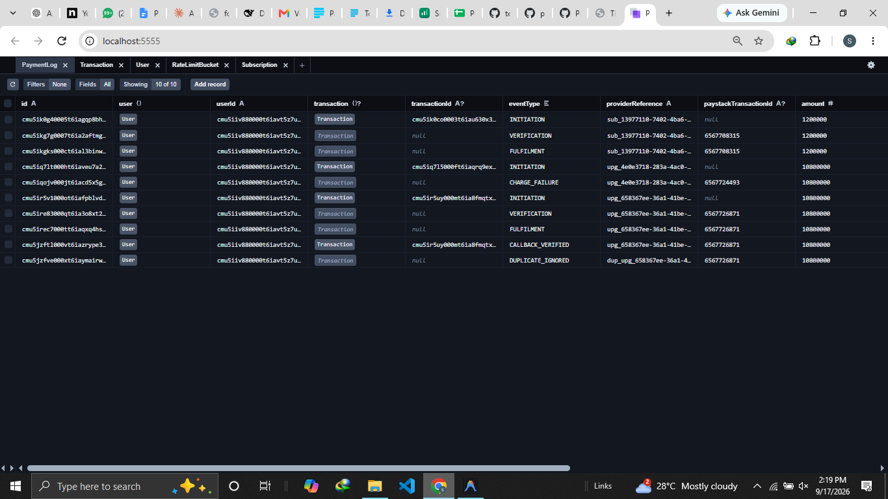
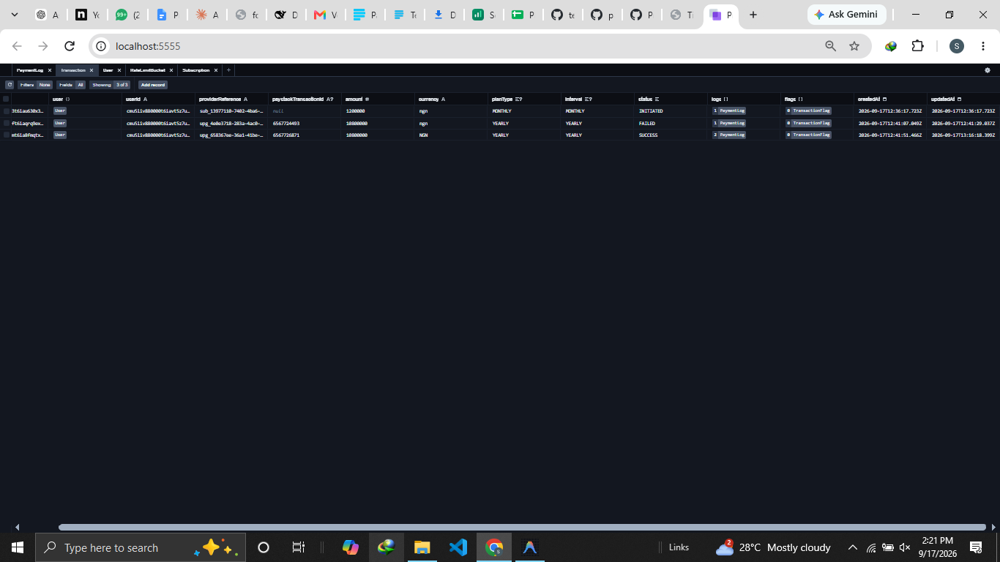
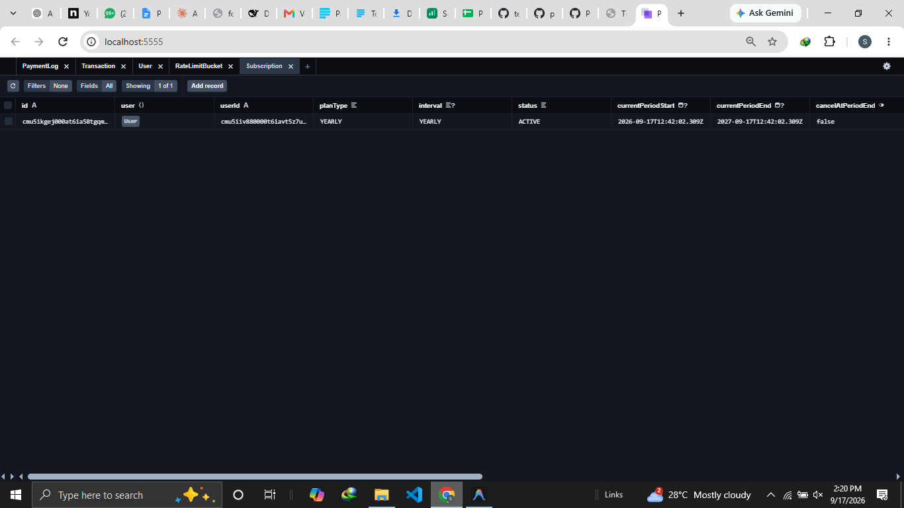
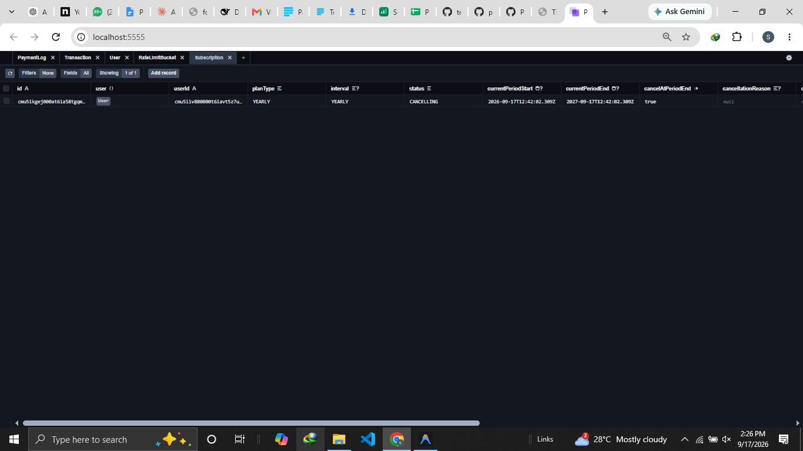
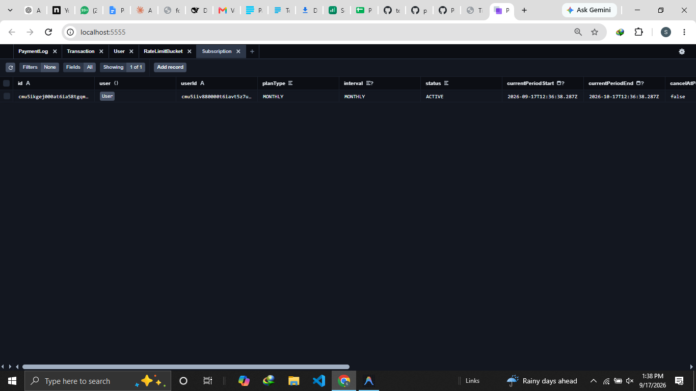
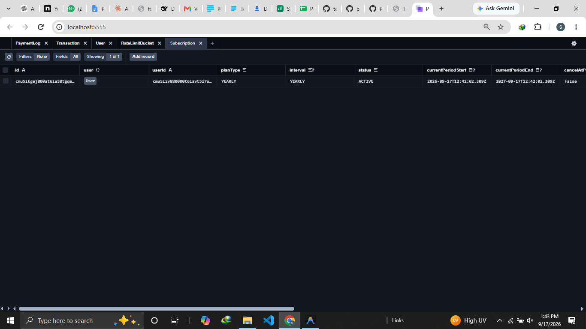
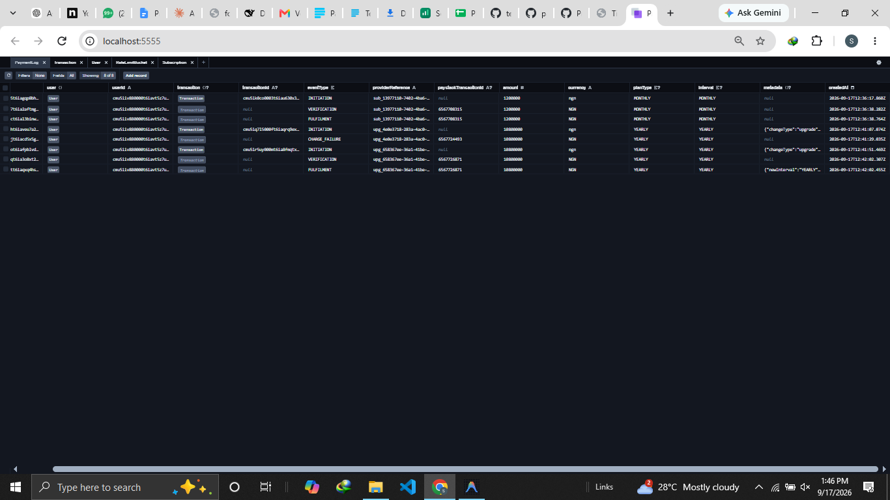
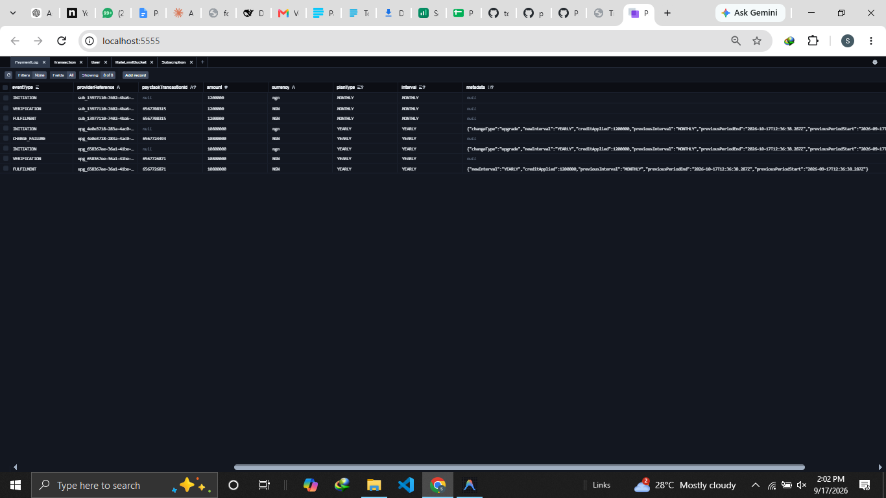

# Documentation — Titife Payment & Subscription Slice

## 1. What This Is

A small billing app. One signed-in user, three plans (Free/Monthly/Yearly), paid through **Paystack (test mode)**, priced in **NGN**. You subscribe, upgrade, downgrade, cancel — and your plan updates correctly at each step. The real work is the plumbing: the payment flow, the audit log, and the rules that keep money and access safe.

**Not auto-renewing.** Every charge is a one-off payment via Paystack's hosted checkout. When the paid period ends, you revert to Free unless you pay again.

## 2. How To Run It

Needs: Node.js LTS, PostgreSQL, a Paystack test-mode key.

```bash
cp .env.example .env        # fill DATABASE_URL, PAYSTACK_SECRET_KEY, NEXT_PUBLIC_APP_URL
npm install && npx prisma migrate dev && npm run dev
```

Open `http://localhost:3000`, click "Sign in as Test User". Auth is a stand-in (swap seam in `src/server/auth/index.ts`).

Extra tools: `npx ts-node scripts/run-expiry-sweep.ts` (lapse ended terms, apply pending downgrades) and `npx ts-node scripts/run-reconciliation.ts` (find verified-but-never-fulfilled payments).

## 3. The Flow

- **Subscribe.** Clicking Subscribe hits `/api/checkout/initiate` → checks sign-in, rate-limits (10/min), makes a reference (`sub_...`), writes an **INITIATION** log row, then redirects to Paystack's hosted checkout. Card data never touches this app.
- **Return page.** Paystack sends you to `/checkout/return?reference=...`. The page asks Paystack server-to-server (Verify Transaction): "did this succeed?" The API's answer — not the URL — is what matters. Success + matching amount/currency → write **VERIFICATION** then **FULFILMENT**, and update the subscription, atomically.
- **Webhook.** Paystack also *pushes* `charge.success` to `/api/webhooks/paystack`. Signature checked first (HMAC-SHA512; mismatch = 400, nothing processed), a **CALLBACK_VERIFIED** row is written, then fulfilment unless a **DUPLICATE_IGNORED** row exists. Return page and webhook race; first in wins, second is ignored.
- **Upgrade (Monthly → Yearly).** Popup shows a live quote (days left, credit, charge); on confirm, hosted checkout for the prorated amount (`upg_...`). On success the plan becomes Yearly from today, breakdown stored in the log.
- **Downgrade.** A warning says you keep access until period end; nothing charged now. It records a pending change; the **expiry sweep** applies it at period end (no new access — you'd pay manually).
- **Cancel.** Confirmation with optional reason. On confirm: CANCELLING + `cancelAtPeriodEnd = true`, **access end date unchanged**, Free at period end. You paid for the period, so you get it.

## 4. The Data Model

- **User** — one user record.
- **Subscription** — current plan: type, interval, status, period start/end, cancellation state, pending downgrade, saved auth code.
- **Transaction** — one row per payment attempt (INITIATED → VERIFIED → SUCCESS, or FAILED/REFUNDED).
- **TransactionFlag** — extra notes: `DUPLICATE_CHARGE`, `STUCK`.
- **PaymentLog** — the immutable audit trail (INITIATION, VERIFICATION, CALLBACK_VERIFIED, CHARGE_SUCCESS, CHARGE_FAILURE, FULFILMENT, REFUND_PROCESSED, DUPLICATE_IGNORED). **Source of truth.**
- **RateLimitBucket** — DB counter, 10 checkouts/min/user.

**Idempotency:** `PaymentLog` is unique on `(providerReference, eventType)` and `(paystackTransactionId, eventType)` — the same event twice is refused.

## 5. The Concepts

- **Verification & fulfilment.** Two paths update your plan: the return page and the webhook. Both call Paystack, check amount/currency, write the same log rows. First wins; second is absorbed as a duplicate.
- **Idempotency / duplicate webhooks.** Before writing an event, the app checks if it already exists; if so it logs **DUPLICATE_IGNORED** and changes nothing — no double-entitlement.
- **Webhook signature.** Raw body → HMAC-SHA512 with the secret key → compare to `x-paystack-signature`. No match = 400, nothing processed. **CALLBACK_VERIFIED** proves the webhook was genuine, not that payment succeeded.
- **Entitlement.** What plan you have, read from the DB: no subscription → Free; Free/expired → Free; paid + period running → your plan. Cancelled-at-period-end keeps access until the paid end date.
- **Non-recurring.** Paystack's native Subscriptions/Plans aren't used. No auto-renewal, no saved-card off-session charging, no PAST_DUE retry (the enum value is never set). The app owns your period dates; you always initiate the next payment.
- **Cancellation at period end.** CANCELLING + `cancelAtPeriodEnd = true`, `currentPeriodEnd` untouched, Free at period end. Stop future renewal, not paid-for access.
- **Proration (Monthly → Yearly).** Unused Monthly time as credit against Yearly (integer math, no floats): `credit = days × daily rate; charge = yearly − credit`. *Day 12 of 30:* 18 days left, rate 40,000/day, credit **₦7,200**, charge **₦112,800**. New term starts today; breakdown stored in the log; popup and charge use the same code.
- **Downgrade at period end.** Records `pendingPlanType` only; access runs to period end, then the sweep switches plans and clears dates — no new term, no auto-charge.
- **Failed/abandoned payments.** `failed`/`abandoned` → CHARGE_FAILURE, attempt marked FAILED, nothing granted, "plan unchanged" + Try Again. In-progress → "still processing", refresh. Unexpected → "not confirmed". Abandoned checkouts get no failure webhook, so the return page records it.
- **Atomicity & 20s timeout.** Log write and plan update commit together or not at all. The default 5s timed out when webhook and return page raced on a lock; raised to 20s (10s wait).
- **Rate limiting & security.** 10 checkouts/min/user via atomic DB counter (fails closed if DB is down). Webhooks signature-checked. No card data ever reaches the app — only Paystack's tokens are stored.

**Assessment evidence (duplicate webhook):**





**Assessment evidence (cancellation):**



**Assessment evidence (upgrade, lifecycle, proration):**






### Questions Answered

**Where is entitlement granted?** Two server-side places, both atomic: the return page and the webhook. Visiting the return URL directly still makes it ask Paystack "did this succeed?" — a fake reference gets nothing.

**Prove/dispute a charge from 3 months ago?** Query the log:

```sql
SELECT "eventType","providerReference","paystackTransactionId","amount","currency","metadata","createdAt"
FROM "PaymentLog" WHERE "userId" = '<USER_ID>' ORDER BY "createdAt" ASC;
```

A real charge runs INITIATION → VERIFICATION → CALLBACK_VERIFIED → CHARGE_SUCCESS → FULFILMENT on one reference. VERIFICATION without FULFILMENT = stuck (reconciliation finds it).

**Why ₦112,800 on day 12 of 30?** `credit = roundHalfUp(18 × 1,200,000, 30) = 720,000`; `charge = 12,000,000 − 720,000 = 11,280,000`. Integer round-half-up only.

**Yearly paid twice in a minute?** Two separate checkouts while ACTIVE → the second webhook auto-refunds via Paystack's Refund API and logs REFUND_PROCESSED + DUPLICATE_CHARGE + FULFILMENT (`refunded`) + DUPLICATE_IGNORED; plan unchanged. Same webhook re-delivered → constraint logs DUPLICATE_IGNORED, nothing else.

## 6. What Went Wrong

1. **Transactions timed out** — the 5s default was too short when a raced webhook held a lock; raised to 20s.
2. **Log table renamed** — `PaymentEvent` → `PaymentLog` to match how it's used.
3. **Declined cards stranded users on Paystack** — Paystack only auto-redirects on success; added `cancel_action` so failures return, get logged, and are marked FAILED.
4. **Abandoned checkouts looked "in progress"** — they never trigger a failure webhook; the return page now marks the attempt FAILED too.

## 7. What This Slice Does Not Handle

- Auto-renewals / saved-card recharging (auth code stored, never used to charge).
- More than one paid plan; teams/orgs; non-NGN currencies.
- User-initiated refunds (except duplicate-charge auto-refund).
- Emails/notifications; admin dashboard; feature gating; real auth (stand-in with swap seam).

## 8. If I Built This Again

- Compute the plan from the log on read — one source of truth, nothing to reconcile.
- Build the Transaction summary in from day one.
- Make the expiry sweep production-grade (batching, retries, monitoring).
- Keep idempotency as-is (DB constraints + "already fulfilled" catch).
- Keep the non-recurring design — one proration, computed once, charged once; add recurring billing later as a separate job on top of the log.